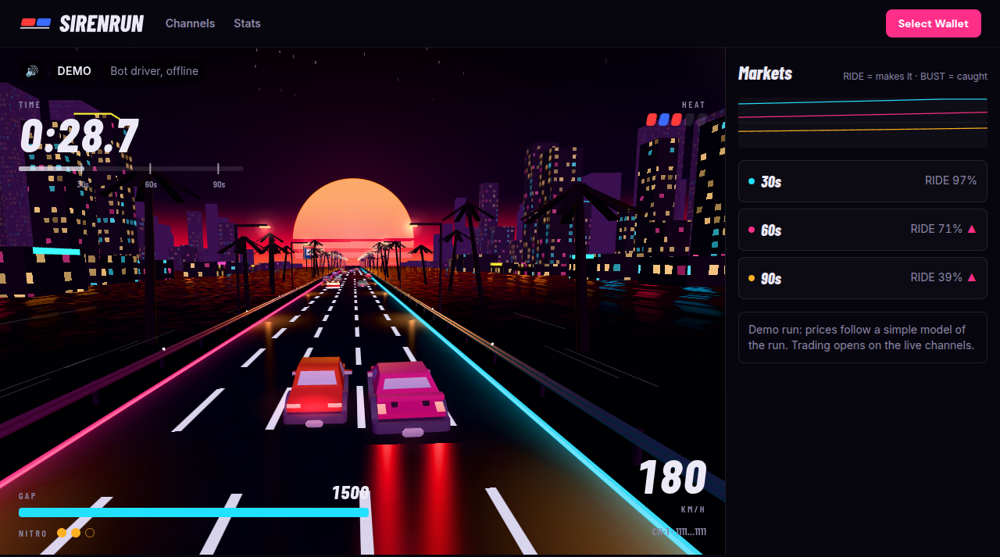
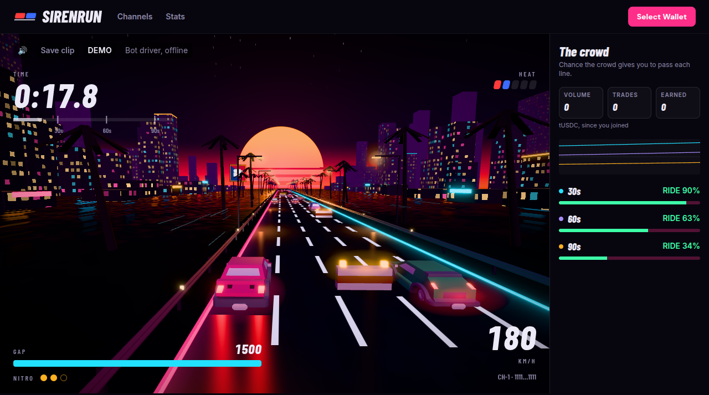
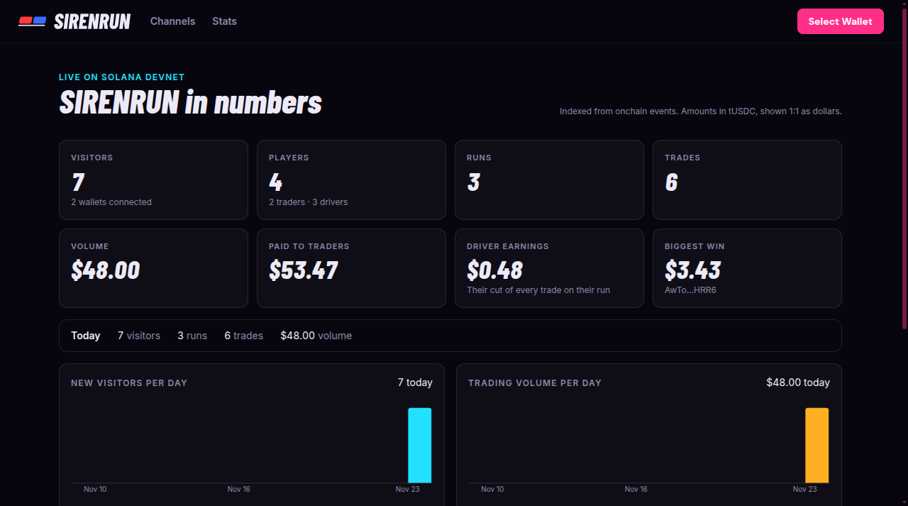
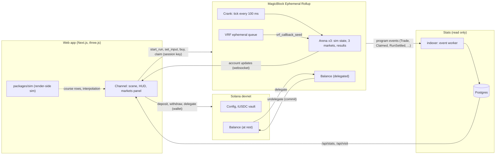

<p align="center">
  <picture>
    <source media="(prefers-color-scheme: dark)" srcset=".github/assets/logo-dark.svg">
    
  </picture>
</p>

<p align="center">
  
</p>

A getaway-driving game that runs onchain inside a MagicBlock Ephemeral Rollup.

One player drives and tries to stay ahead of the police. Everyone else trades on how long
the run lasts, with three markets per run: survives 30 s, 60 s, 90 s. Press **RIDE** if you
think the driver makes the line, **BUST** if you think the cops get there first. As on other
trading apps, RIDE (the long side), wins and gains are green; BUST and losses are pink.

Markets settle from the game state the moment a line is crossed or the car is caught.
No oracle and no manual resolution.



### Driver view and stats

The driver sees the road, their controls and how the crowd is betting, with no trade
buttons. Everyone else gets the trading panel. Wallet PnL, total trades and platform
analytics come from an indexer that stores the program's events.

Watchers see their open positions over the road, get a first-visit guide with a live
example payout, and can share a run's result; phones buzz when a line pays or a position
wins. The lobby shows driver and trader leaderboards.

| Driver view | Stats page |
|---|---|
|  |  |

## How a run works

1. **Drive.** A driver pays a small entry fee and a bond and starts a run on an idle channel.
   A 10 s countdown rolls the course from verifiable randomness. Then the car moves forward
   on its own; the driver changes lanes around traffic and roadblocks and has three nitro
   charges, paid per charge used (unused ones cost nothing). Every hit costs speed, the police get faster every second, and the run ends
   when the gap reaches zero.
2. **Trade.** Spectators buy RIDE or BUST on each line from a constant-product market the
   house seeds at that line's real odds, so nobody gets a free first trade. Prices move with
   every trade. The driver cannot trade their own run.
3. **Settle.** A line resolves RIDE the tick the run passes it, or BUST the tick the car is
   caught. Winning shares pay 1 tUSDC each and are claimed automatically. The driver earns
   the 2% fee on every trade on their run, plus half of what BUST bettors lost on each line
   they pass, and gets the 5 tUSDC bond back after it. On a bust, the bond only covers what
   BUST bets won; that goes to the fans who bet RIDE on the busted lines, or to the house if
   there were none. If nobody bet against the driver, they lose nothing. See [Run economics](docs/onchain-program.md#run-economics).

The simulation is deterministic integer code. The program runs it in Rust; the browser runs
a TypeScript port of the same rules to draw the course ahead, and shared test vectors keep
the two in step.

## How MagicBlock is used

| Feature | Where | What it does here |
|---|---|---|
| Ephemeral Rollup | Three `Arena` accounts and every player's `Balance` are delegated to the Asia devnet ER | The 10 Hz simulation and live trading run as free, fast ER transactions |
| Cranks | `start_run` schedules `tick` every 100 ms | The world moves without a server; nobody, not even the driver, can skip a tick |
| VRF | `start_run` requests randomness from the ephemeral queue; `vrf_callback_seed` stores it | Each course comes from a seed no one can predict or pick |
| Session keys | `start_run`, `set_input`, `buy`, `claim`, `undelegate_balance` | One signature starts an hour-long session; driving and trading need no wallet popups |
| Commit and undelegate | `undelegate_balance` | A balance goes back to Solana so its owner can withdraw |

Solana devnet holds the money: one SPL vault for test USDC, deposits and withdrawals.
Details and the pinned SDK versions are in [docs/magicblock.md](docs/magicblock.md).

## Architecture



The indexer only reads events; runs and markets settle onchain and the game works without
it. Details in [docs/architecture.md](docs/architecture.md#stats-and-analytics).

The client never waits on the network inside the render loop: arena snapshots arrive
about ten times a second, and the scene interpolates between them. The run lifecycle as a
sequence diagram is in [docs/architecture.md](docs/architecture.md#run-lifecycle).

## Devnet

| What | Address |
|---|---|
| Program | `6D65tPwcsoSoPK2qcXD87jcUQpMxwCjfX7tX7tKARiZ4` |
| Config PDA | `BwF2fRi8vCXBUAuJx1GajG61ymKAF4rFE9QRTi4YdWyu` |
| Arenas 0, 1, 2 | `CSLE8p4H2zB2RRbsaFtKVYh5YKZVpRoc5tdrABMRV66B`, `2tRiPD6dbwchUBbte1X434Dy4NMNus1Xj4NwGgXSbpep`, `3PSeBtQ8WvVehxrN98QQdsAuaQk5sn45XD7KRk57KEnm` |
| tUSDC mint | `6B4g5L3Ep7FwhmsnNC5saupGySfs39T8o8BWTWFLVWQU` |
| Ephemeral Rollup | `https://devnet-as.magicblock.app` |

Setup, the faucet and the smoke script are described in [docs/devnet.md](docs/devnet.md).

## Run it locally

You need Node 24 and pnpm 11. The web app talks to the devnet deployment above, so it runs
without any local validator.

```bash
pnpm install
pnpm dev            # http://localhost:3000
```

- `/` plays an offline attract run, `/demo` an offline run with read-only markets, and
  `/lobby` lists the three devnet channels.
- To drive or trade, connect a devnet wallet. The onboarding walks through test USDC from
  the faucet, a deposit, and starting a session. The faucet needs `FAUCET_SECRET_KEY` in
  `app/.env.local` (see `.env.example`).
- `/stats` and the wallet PnL need `DATABASE_URL` (Postgres) in `app/.env.local`, and the
  indexer running: `pnpm --filter @sirenrun/indexer start` with the same variable in
  `indexer/.env`. Without them the game still works and the stats show "unavailable".

Program and tests need Rust, Anchor 1.2.2 and the Solana CLI 4.1.2 (versions and reasons in
[docs/architecture.md](docs/architecture.md)):

```bash
anchor build
cargo test -p sirenrun                 # simulation, markets, accounts
(cd tests/magicsvm && cargo test)      # base layer and rollup in one process
pnpm -r typecheck && pnpm -r test      # sim parity, SDK, app
```

## Repository

| Path | Contents |
|---|---|
| `programs/sirenrun` | Anchor program: instructions, accounts, the pure simulation and market math |
| `packages/sim` | TypeScript port of the simulation, checked against shared vectors |
| `packages/sdk` | Typed client: PDAs, instruction builders tagged base or rollup, subscriptions |
| `app` | Next.js web client: landing, lobby, channel, demo, stats, and the stats API routes |
| `indexer` | Worker that stores program events in Postgres for PnL and analytics |
| `scripts` | Devnet setup and the end-to-end smoke run |
| `tests/magicsvm` | Integration tests with base layer and rollup in one process |

## Docs

| Doc | Covers |
|---|---|
| [docs/architecture.md](docs/architecture.md) | Stack, repo layout, data flow, base layer vs rollup |
| [docs/game-design.md](docs/game-design.md) | Simulation rules, constants, balance targets |
| [docs/onchain-program.md](docs/onchain-program.md) | Accounts, instructions, market math, invariants |
| [docs/magicblock.md](docs/magicblock.md) | Delegation, VRF, cranks, session keys, local setup |
| [docs/devnet.md](docs/devnet.md) | Addresses, setup, faucet, smoke run, stats indexer |

## Roadmap

- Client-side prediction for the driver's own car, reconciled with each snapshot.
- Commit the arena to Solana at the end of every run.
- Selling positions before a line resolves.
- Driver-chosen bond sizes (a bigger bond allows a bigger BUST market).
- Before any mainnet use: an audit, the upgrade authority on a multisig, and an emergency
  pause that never blocks claims or withdrawals.

## Status

Devnet only. Not audited. Test tokens only.

## Links

[github.com/sirenrun](https://github.com/sirenrun) · [@sirenrun on X](https://x.com/sirenrun)

## License

[MIT](LICENSE)
