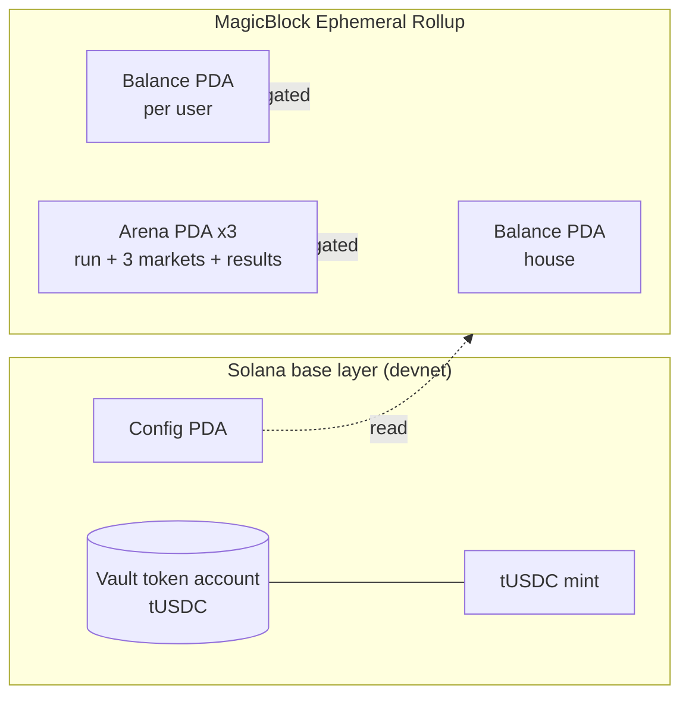
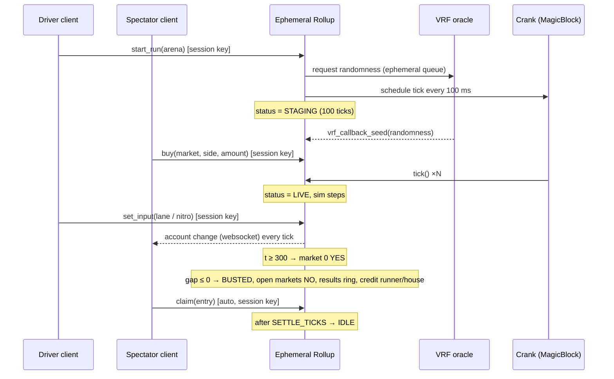

# Architecture and stack

## Stack

Versions checked against crates.io, npm and the MagicBlock dev skill on 2026-11-20.
Program-side crates were compile-tested together (see [magicblock.md](magicblock.md#1-versions)).

| Layer | Choice | Why |
|---|---|---|
| Program | Rust, **Anchor 1.2.2**, Solana (Agave) CLI **4.1.2** | Latest stable Anchor; 4.1.2 is the Solana version its release notes recommend. |
| MagicBlock (Rust) | `ephemeral-rollups-sdk` **0.18.0** (`anchor`, `vrf`, `crank`); `session-keys` **3.1.1** (`no-entrypoint`) | 0.18 works with MagicBlock validator 1.x and 2.0. The public Asia ER runs 1.x, so the 0.20 line (2.0 only) is not an option yet. |
| Token | `anchor-spl` 1.2.2, one SPL mint "tUSDC" (6 decimals) we create on devnet | Real token flow without real money. |
| Monorepo | **pnpm 11** workspaces, Node **24 LTS** | Shared `sim`, `sdk`, `test-vectors` packages between app and tests. |
| Web app | **Next.js 16** (App Router) + **React 19.3** + **TypeScript 6.0** | TypeScript 7 is out, but `typescript-eslint` supports only `<6.1`. |
| 3D | **three.js 0.187** via `@react-three/fiber` 9, `@react-three/drei` 10, `@react-three/postprocessing` 3 | R3F keeps scene code in React. Fiber 9 requires React `<19.4`. |
| App state | `zustand` 5 | Tiny; render loop can read the store without re-rendering React. |
| Styling | Tailwind CSS 4 | Fast HUD/UI work. |
| Solana TS | `@solana/web3.js` **1.99**, `@anchor-lang/core` **1.2.2**, `@magicblock-labs/ephemeral-rollups-sdk` **0.18.0** | The Anchor and MagicBlock TS clients both require web3.js 1.x, so the app stays on it. |
| Wallet | Solana Wallet Adapter (Phantom, Solflare, Backpack) | Built on web3.js 1.x, same as the clients above. |
| Session keys (TS) | `@magicblock-labs/gum-sdk` | The client MagicBlock's session-keys example uses. |
| Charts | a tiny custom SVG/canvas sparkline | 3 lines × ~1500 points; no chart library needed. |
| Audio | `howler` | Simple, handles mobile unlock. |
| Lint / format | ESLint 10 + `typescript-eslint`, `@next/eslint-plugin-next`, `eslint-plugin-react-hooks`; Prettier 3 for code (not Markdown); `rustfmt`, `clippy` | `eslint-config-next` pins plugins that stop at ESLint 9, which is end-of-life. |
| Tests | `cargo test` (sim, market), Anchor TS tests on a local base validator + local ephemeral validator, `vitest` 5 for TS packages | |
| CI | GitHub Actions | Build and unit tests on every PR. |

**Not used in MVP:** Socket.IO / custom WebSocket server, database, indexer, BOLT ECS.
The ER's own websocket (`onAccountChange`) is the real-time feed. A server would add a
trust point. (Socket.IO can come later for chat/presence.)

## Repo layout

```
sirenrun/
├─ README.md
├─ docs/
├─ Anchor.toml
├─ Cargo.toml                    # workspace
├─ programs/sirenrun/
│  └─ src/
│     ├─ lib.rs                  # #[ephemeral] #[program] mod, thin handlers
│     ├─ constants.rs
│     ├─ errors.rs
│     ├─ state/{config,balance,arena}.rs
│     ├─ instructions/{init_config,init_balance,deposit,withdraw,delegate,undelegate,
│     │                init_arena,start_run,vrf_callback,tick,set_input,buy,claim}.rs
│     ├─ sim/{mod,course,step}.rs   # pure
│     └─ market/{mod,fpmm}.rs       # pure
├─ packages/
│  ├─ sim/        # TS port: course.ts, step.ts, constants.ts (+ vitest parity tests)
│  ├─ sdk/        # pdas.ts, connections.ts, ix/*.ts, accounts.ts (decoders), types
│  └─ test-vectors/sim.json, fpmm.json
├─ app/           # Next.js
│  ├─ app/{page.tsx, lobby/page.tsx, c/[id]/page.tsx}
│  ├─ components/{hud,markets,wallet,onboarding,results}/
│  ├─ game/{Scene.tsx, Road.tsx, Car.tsx, Police.tsx, Obstacles.tsx, interpolation.ts}
│  ├─ stores/{arena.ts, session.ts, balance.ts}
│  └─ lib/{subscribe.ts, clip.ts, audio.ts}
├─ scripts/  # init-devnet.ts, create-mint.ts, seed-house.ts, keeper-tick.ts (fallback)
└─ tests/    # sirenrun.ts (localnet + local ER)
```

## Accounts at a glance



- Money (tokens) never moves inside the ER. Inside the ER we only move **numbers** in
  Balance accounts. Tokens move on the base layer at deposit/withdraw. This avoids
  ephemeral SPL token custody in the MVP (simpler, fewer unknowns).
- Invariant: `vault.amount >= sum(all Balance.available) + outstanding claim liability`.

## Run lifecycle



## Connections in the client

- `baseConnection` → Solana devnet RPC (or `https://rpc.magicblock.app/devnet`).
- `erConnection` → `https://devnet-as.magicblock.app` (Asia) with its
  websocket. The arena must be delegated to the **same** validator identity (Asia:
  `MAS1Dt9qreoRMQ14YQuhg8UTZMMzDdKhmkZMECCzk57`). Keep region in one config value.
- Optionally the Magic Router `https://devnet-router.magicblock.app` routes automatically.
  MVP uses explicit connections to keep behaviour obvious; try the router in a spike.
- `packages/sdk/connections.ts` exports both, and each instruction builder is typed with
  its target (`"base" | "er"`).

## Real-time data flow

1. On channel page mount: `erConnection.onAccountChange(arenaPda, cb, "processed")`.
2. `cb` decodes the arena account (Borsh via Anchor coder) into a typed snapshot and pushes
   `{snapshot, receivedAt}` into the arena store (keep last 2 + market price history).
3. R3F `useFrame` reads the store (not via React state) and interpolates.
4. Trade ticker: diff reserves between consecutive snapshots → derive "someone bought
   X of side Y". Wallet attribution needs tx data; MVP shows anonymous ticker, or
   fetches the latest signatures on the ER for the arena every second (stretch).

## Where each MagicBlock feature is used

| Feature | Where | Why it matters |
|---|---|---|
| Ephemeral Rollup | Arena + Balance accounts | Free, fast txs for 10 Hz sim and live trading |
| Cranks | `tick` scheduled at `start_run` | The world moves without a server |
| VRF (ephemeral queue) | `start_run` → `vrf_callback_seed` | Course can't be pre-learned or rigged by us |
| Session keys | `set_input`, `buy`, `claim`, `start_run` | No wallet popups mid-run |
| Commit / undelegate | `undelegate_balance` for withdraw; commit arena at settle | State lands back on Solana |

## Environments

| Env | Base | ER | Use |
|---|---|---|---|
| local | `mb-test-validator` :8899 | `ephemeral-validator` :7799 | tests, fast iteration |
| devnet | Solana devnet | `devnet-as.magicblock.app` | public demo |
| mainnet | not yet | contact MagicBlock | after devnet is proven |
